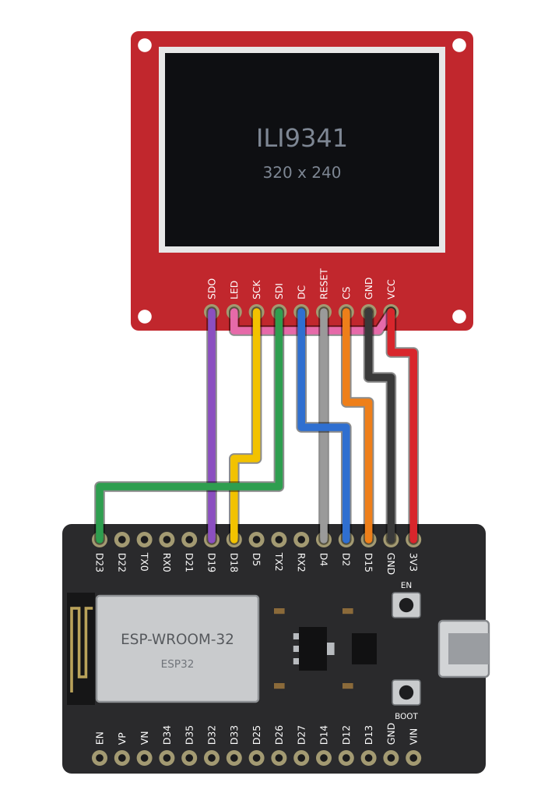
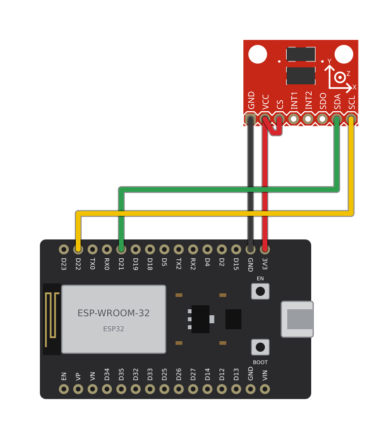
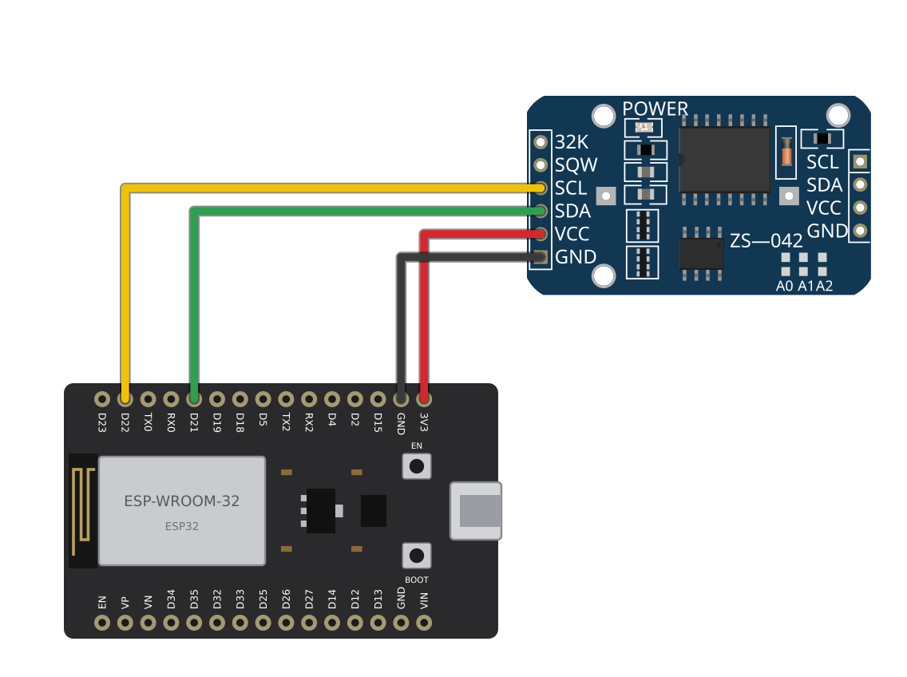
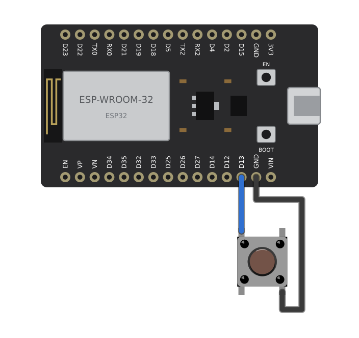

# Analizador de vibraciones

Instrumento de mano que mide la vibración con un acelerómetro y la muestra en una pantalla, de dos formas: como espectro de frecuencias o como forma de onda. Sirve para ver a qué frecuencia vibra una máquina y con cuánta fuerza.

Está hecho con un ESP32, un acelerómetro ADXL345, una pantalla ILI9341 y un reloj DS3231.

## Qué muestra

Un botón cambia entre los dos modos:

- **Espectro:** una barra por frecuencia, de 0 a 400 Hz. Debajo escribe la frecuencia del pico más alto y su amplitud.
- **Forma de onda:** la señal medida durante 320 ms, centrada en cero. Debajo escribe la escala y el valor eficaz (RMS).

En los dos la escala vertical se ajusta sola a la señal, y arriba a la derecha aparece la hora del reloj.

## Conexiones

Los cuatro módulos van a la misma placa ESP32. Cada diagrama enseña uno; la placa aparece con el conector USB a la derecha.

**Pantalla**



| Pantalla ILI9341 | ESP32 | Cable |
|---|---|---|
| VCC | 3V3 | Rojo |
| GND | GND | Negro |
| CS | D15 | Naranja |
| RESET | D4 | Gris |
| DC | D2 | Azul |
| SDI (MOSI) | D23 | Verde |
| SCK | D18 | Amarillo |
| SDO (MISO) | D19 | Morado |
| LED | VCC de la pantalla | Rosa |

El orden de los pines cambia de un módulo a otro: hay que guiarse por el nombre impreso junto a cada pin, no por su posición en el dibujo.

**Acelerómetro**



| ADXL345 | ESP32 | Cable |
|---|---|---|
| VCC | 3V3 | Rojo |
| GND | GND | Negro |
| SDA | D21 | Verde |
| SCL | D22 | Amarillo |
| CS | VCC del sensor | Rojo |

El pin CS unido a VCC deja el sensor en modo I2C.

**Reloj**



| DS3231 | ESP32 | Cable |
|---|---|---|
| VCC | 3V3 | Rojo |
| GND | GND | Negro |
| SDA | D21 | Verde |
| SCL | D22 | Amarillo |

El reloj y el acelerómetro comparten los pines D21 y D22: los dos van al mismo bus I2C.

**Botón**



| Botón | ESP32 | Cable |
|---|---|---|
| Una pata | D13 | Azul |
| La pata de la esquina opuesta | GND | Negro |

No necesita resistencia: el programa usa la que trae la placa.

Los diagramas los dibuja `docs/conexiones/generar.py`, que coloca las piezas de `docs/conexiones/piezas/` y traza los cables entre sus pines. Las ilustraciones del acelerómetro, del reloj y del botón vienen de la biblioteca de piezas de [Fritzing](https://fritzing.org), con licencia [CC BY-SA 3.0](https://creativecommons.org/licenses/by-sa/3.0/).

## Cómo funciona

1. Toma 256 muestras de un eje del acelerómetro, a 800 muestras por segundo.
2. Les resta su media, que es la parte de la gravedad que cae sobre ese eje, para quedarse solo con la vibración.
3. En el modo de espectro aplica una ventana de Hamming y calcula la transformada de Fourier. Cada barra es la amplitud, en m/s², de una franja de 3.125 Hz.
4. Dibuja el resultado y vuelve a empezar.

Con 800 muestras por segundo el espectro llega hasta 400 Hz, que es también el ancho de banda del sensor a esa velocidad. Una vibración más rápida que eso no se puede medir con este montaje.

## Cargar el programa

El programa está en `firmware/` y se compila con [PlatformIO](https://platformio.org/), que descarga las bibliotecas que necesita:

```sh
cd firmware
pio run -t upload
```

### Ajustes

Están en `firmware/include/config.h`:

- `EJE`: el eje del acelerómetro que se analiza. Conviene que sea el que queda en la dirección de la vibración.
- `MUESTRAS`: más muestras dan barras más estrechas en frecuencia, a cambio de tardar más en cada medición.
- `ESPECTRO_MINIMO` y `SENAL_MINIMA`: por debajo de estos valores la escala deja de ampliarse, para que el ruido del sensor en reposo no llene la pantalla.
- Los pines de la pantalla y del botón.

## Cambios respecto a la versión original

La primera versión era un solo archivo para el IDE de Arduino. Al reordenarla se corrigió esto:

- Decía muestrear a 60 000 Hz, pero el sensor entregaba 100 lecturas por segundo, así que el espectro no correspondía a frecuencias reales. Ahora el sensor y el programa van los dos a 800 Hz y el eje de frecuencias es correcto.
- El espectro incluía la gravedad, que tapaba todo lo demás. Ahora se resta antes de calcular.
- El segundo modo multiplicaba la aceleración por una constante y lo llamaba velocidad. Ahora muestra lo que realmente se mide, la aceleración en m/s².
- La gráfica se dibujaba más ancha que la pantalla. Ahora la pantalla va apaisada y la gráfica cabe entera, con sus ejes rotulados.
- El botón solo se leía una vez por segundo, así que había que mantenerlo pulsado. Ahora basta un toque.
- El reloj se inicializaba pero no se usaba, y sin él el programa no arrancaba. Ahora pone la hora en pantalla y es opcional.
- Los dos modos usan el mismo eje; antes uno leía X y el otro Y.

## Lo que falta

- Guardar las mediciones con su hora, que es para lo que está el reloj.
- Mostrar la velocidad de vibración, en mm/s, que es la medida habitual en mantenimiento. Hay que integrar la aceleración.

## Licencia

El código se publica con la licencia [Apache 2.0](LICENSE). Los diagramas de `docs/conexiones/` usan ilustraciones de Fritzing y se publican con la licencia CC BY-SA 3.0, que es la de esas ilustraciones.
